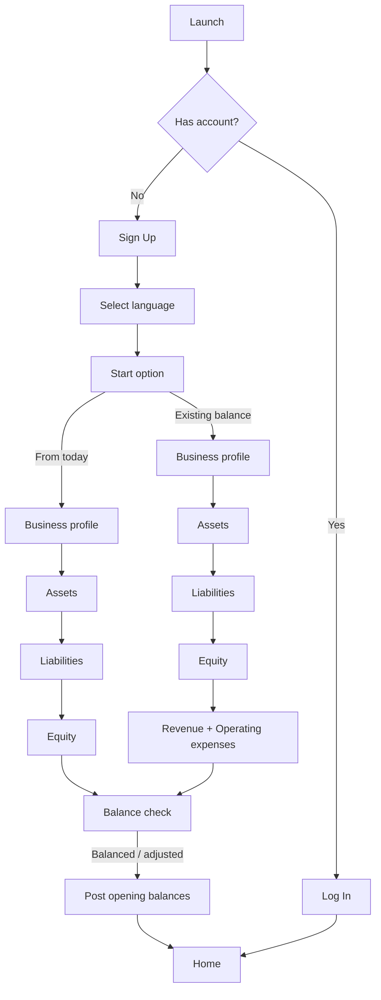
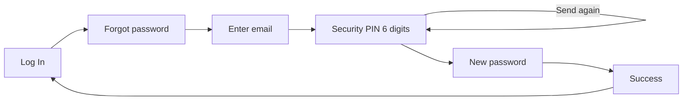
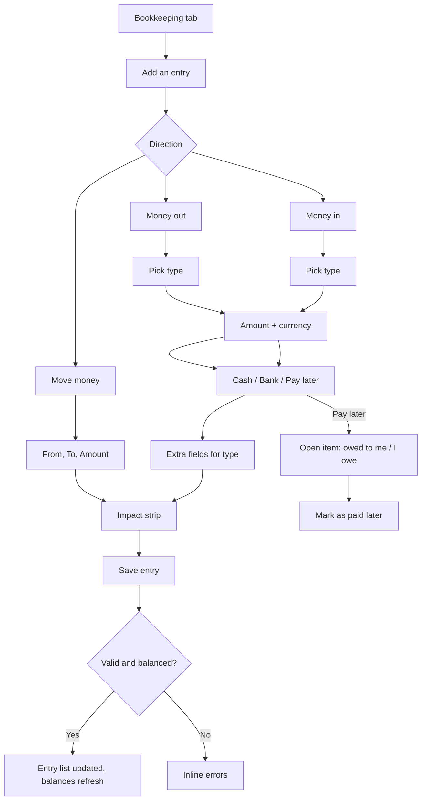
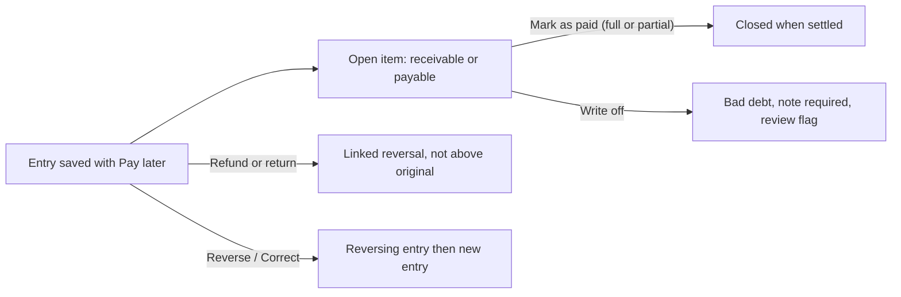
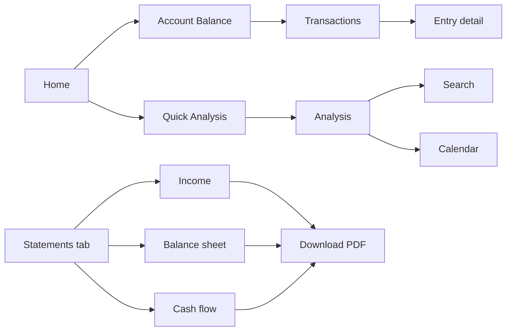
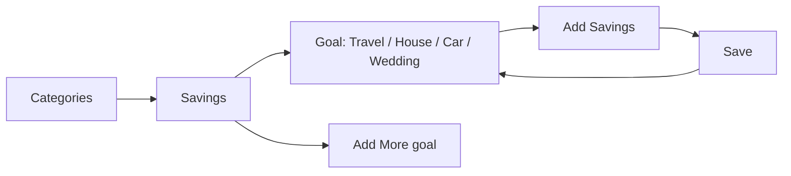
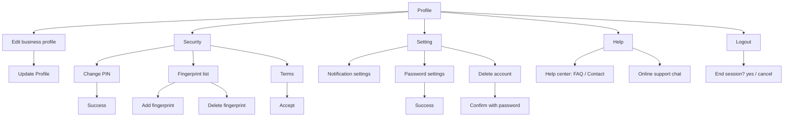

# FINEXT — Modules, Functions and User Flows

Build spec for Claude Code. Read this together with `FINEXT_STYLE_GUIDE_MERGED.md` (visual rules). This file says **what to build and how users move through it**. The style guide says how it looks.

- **Product:** Finext, a mobile bookkeeping and financial-health app for small shops (SMEs) in Cambodia. Bilingual Khmer / English (UK). Currencies USD and KHR.
- **Figma file:** `iWtJcoDJn6HefdaGOTN8Pe` (Finext - Mobile App). Screens are on the page **App** (`5:4918`). Frame size 430 × 932.
- **Source note:** the Figma page **User-flow** (`56:2759`) is empty. The flows below are derived from the numbered screens on the App page, the accounting rules (`posting_rules.json`, entry-rule spreadsheet), the ratio framework spreadsheet and the financial statement templates. Items marked **(open)** are not clear in the design and need an owner decision.

---

## 1. Module map

| # | Module | Purpose | Figma group (node) | Status in Figma |
|---|---|---|---|---|
| 1 | Launch | Splash and entry (Log In / Sign Up / Forgot Password) | `1. Launch` (`5:8876`) | Designed |
| 2 | Onboarding | Language, start option, business profile, opening balances | `2. On Boarding` (`5:8860`) | Designed |
| 3 | Authentication | Sign up, log in, forgot / reset password, PIN, fingerprint | `3. Login / Sign Up` (`5:8822`) | Designed |
| 4 | Home | Dashboard: balances, goals, money in/out, recent transactions | `4. Home` (`5:8629`) | Designed |
| 5 | Notifications | Reminders, updates, transaction alerts | `5.1. Notification` (`5:8554`) | Designed |
| 6 | Account Balance | Balance, income vs expense, transaction list | `6. Account Balance` (`5:8492`) | Designed |
| 7 | Quick Analysis | Weekly revenue/food, savings on goals, monthly chart | `7. Quickly Analysis` (`5:8412`) | Designed |
| 8 | Bookkeeping | **Add entry**: Money in, Money out, Move money, plus entry list | `8. Transaction` (`5:8329`) + new sections | Designed (entry forms for every type) |
| 9.2 | Analysis | Daily / Weekly / Monthly / Year charts, Search, Calendar | `9.2. Analysis` (`5:8236`) | Designed |
| 9.3 | Transactions | Transaction history by month | `9.3 Transactions` (`5:7578`) | Designed |
| 9.4 | Categories and Savings goals | Spending categories, add category, savings goals (Travel, House, Car, Wedding) | `9.4 Categories` (`5:7366`) | Designed |
| 9.4.0 | Financial Statements | Template tiles + the 3 statements | `9.4.0 - A` (`6:11809`) + new section | Tiles designed; 3 statements designed |
| 9.5 | Profile | Edit business profile, Security, Settings, Help, Online support, Logout | `9.5 Profile` (`5:6200`) | Designed |
| 10 | Financial Health (ratios) | Ratio dashboard with green / yellow / red status | (none) | **Not designed** (spec in §11) |

Bottom navigation (5 tabs, component `Bottom Navigation - <name>`):

| Tab | Icon | Goes to | Active variant |
|---|---|---|---|
| Home | house | Module 4, then 6 | `home` |
| Analysis | magnifier + bars | Module 9.2 (and 7) | `analysis` |
| Bookkeeping | pencil on line | Module 8 / 9.3 (entry list + Add an entry) | `bookkeeping` |
| Statements | stacked layers | Module 9.4.0 Financial Statements | `statement` |
| Profile | person | Module 9.5 | `profile` |

**(open)** Where Categories and Savings goals (9.4) are opened from is not shown. Suggested: a "Categories" card on Home and a link in Analysis. The tab labelled "Category" in the Figma nav component is the layers icon and opens Financial Statements.

---

## 2. Global rules (apply to every module)

1. All text goes through i18n (`en-GB`, `km`). Layouts must tolerate Khmer.
2. Every amount input has the **KHR | USD switch**. Store the amount with its currency and an exchange rate used at entry time. Display currency is a user setting. Reference rate 4,000 KHR = 1 USD is a placeholder from settings.
3. Users always type positive numbers. The app derives direction (money in / out) from the entry type.
4. **Posted entries are never edited or deleted.** "Edit" = reverse the original (swap debits and credits, link to original) and post a new entry. Deleting a transaction in the UI means "Reverse".
5. Never show account codes or "debit / credit" in the UI.
6. Every list screen needs loading, empty and error states.
7. Auth-gated: all modules except 1 to 3 require a session. Idle timeout then PIN or fingerprint.
8. Currency format: `$4,000.00`, `5,000,000 ៛`, negatives `-$100.00`.

---

## 3. Module specs

Each module lists **screens**, **functions** (what the code must do) and **data**.

### 3.1 Launch (1)
- Screens: Launch A (logo), Launch B (tagline "Turn your business records to standard", Log In, Sign Up, Forgot Password?).
- Functions: route to Log In, Sign Up, or Forgot Password. If a valid session exists, skip to Home.

### 3.2 Onboarding (2)
Screens, in order:
1. **Select language**: Khmer, English - UK (single select, Next). Saves locale.
2. **How would you like to start?** Two choices (single select, info icon shows a tooltip):
   - *Start new balance from today* → enter balance sheet info only.
   - *Starting with existing balance* → enter balance sheet info **and** income statement for a date range (start/end dates, **cannot be shorter than one month**).
3. **Create business profile**: Business Name, Business Industry (dropdown with icon), Registration Status (dropdown; shows Registration Number when Registered), Start Operation Date, Owner Name, Location, Phone or Email, Main Products or Services.
4. **Enter Business Assets - Current assets**: Cash & bank balances (bank selector, KHR and USD rows, "Add more bank"), Accounts receivable, Inventory, Prepaid & other current assets.
5. **Enter Business Assets - Non-current**: Property, equipment & vehicles, Other long-term assets.
6. **Enter Liabilities - Current**: Accounts payable, Customer deposits & deferred revenue, Accrued expenses & taxes payable, Short-term loans (bank / MFI), Other short-term borrowings.
7. **Enter Liabilities - Non-current**: Long-term loans (bank / MFI, with lender), Lease obligations.
8. **Owner's Equity**: Owner's capital, Retained earnings brought forward, Net profit for the period, Less: owner's drawings.
9. *Only for "existing balance":* **Enter Revenue** (Sales revenue, Cost of goods sold) and **Operating Expenses** (Salaries & wages, Rent, Utilities, Marketing & advertising, Transport & delivery, Depreciation, Other operating expenses, Other income, Interest expense, Income tax). Each with Start Date / End Date.
- Functions:
  - Per-step validation (numbers, dates, end date at least one month after start).
  - Each balance-sheet field has an info "!" tooltip (plain-language definition, from the template "What to enter" column).
  - **Balance check:** total assets must equal liabilities + equity. If not, show the difference and block Finish (or offer to put the difference into Owner's capital / Retained earnings, as the opening-balance rule does).
  - On finish: post **opening balance entries**, one per balance, dated the day before the first daily entry. The difference goes to Owner's capital / Retained earnings.
  - Create loan records for every loan entered (lender, account 2400 / 2500 / 2600) and asset records for equipment (name, useful life) so depreciation can run.
  - Save business profile and the chosen currency settings.
- Data: `Business`, `OpeningBalance[]`, `Bank[]` (name, logo), `Loan[]`, `Asset[]`.

### 3.3 Authentication (3)
Screens: Create Account, Log In, Forgot Password, Security PIN (6 digits), New Password, Password changed, Security Fingerprint.
- **Create Account:** Full name, Email, Mobile Number, Date of birth, Password, Confirm Password, Terms of Use and Privacy Policy consent, Sign Up, link to Log In.
- **Log In:** Username or email, Password, Log In, Forgot Password?, Use fingerprint to access, Sign Up link. Social sign-up row ("or sign up with") is drawn: **(open)** which providers.
- **Forgot password flow:** enter registered email → Next step → Security PIN (6 digits, Accept, "Send again" with resend timer) → New Password + Confirm → success screen → Log In.
- **Fingerprint:** "Use touch id" or "Or prefer use pin code?" fallback.
- Functions: field validation, password rules, rate limiting, OTP resend, biometric enrolment and fallback to PIN, session token storage (secure storage), auto-logout.

### 3.4 Home (4)
- Shows: greeting ("Hi, Welcome Back / Good Morning"), Total Balance, Total Expense, budget progress (30% of $20,000), status text, Money In Last Week, Money Out Last Week, Profit on goals, Daily / Weekly / Monthly toggle, recent transactions list, notification bell.
- Functions: aggregate balances from the ledger, period toggle, budget status colours (normal / warning at 70% / danger at 100%), open Notifications, open a transaction, "See all" to Transactions.

### 3.5 Notifications (5.1)
- Groups: Today, Yesterday, This Weekend. Types: Reminder (e.g. set up automatic savings), New update, Transaction registered, Expense record advice.
- Functions: list, mark read, tap routes to the related screen (transaction, goal, settings). Driven by the notification settings in 3.14.

### 3.6 Account Balance (6)
- Total Balance, Total Expense, budget bar, Income and Expense summary, "Transactions" list with "See all".
- Functions: balance and period totals, open transaction detail, link to full list.

### 3.7 Quick Analysis (7)
- Revenue Last Week, Food Last Week, Savings on goals, April Expenses bar chart (1st–4th week, y-axis 1k–15k), recent transactions.
- Functions: weekly aggregates, month chart, top spending category.

### 3.8 Bookkeeping (8): Add an entry  — core module
This is the heart of the app. Full UI spec is in the style guide (§6.16–6.26, §9). Behaviour:

**Entry point:** bookkeeping tab → list of entries with "Add an entry" button, or the overview (grouped list for the month, tiles Money in / Money out / Left over).

**Flow of every entry**
1. Choose direction with the tab switch: **Money in | Money out | Move money**.
2. Step 1 **What is it for?** (group cards with chips). Choosing a chip collapses step 1 into a summary row with "Change".
3. Step 2 **How much?** amount with KHR | USD switch.
4. Step 3 **How did you pay / get paid?** Cash, Bank or wallet, Pay later (only where allowed).
5. Extra fields for the type, then Date and Note.
6. Impact strip shows the effect, then **Save entry**.

**Types and posting** (from `posting_rules.json`; `PAY` = Cash 1000 / Bank & wallet 1010, or Accounts receivable 1100 (money in) / Accounts payable 2000 (money out) when Pay later):

| Direction | Type | Pay later | Extra fields | Posting (Dr / Cr) |
|---|---|---|---|---|
| In | Product sale | Yes + customer | Cost (optional, estimated if blank) | Dr PAY, Cr Sales revenue 4000; Dr COGS 5000, Cr Inventory 1200 |
| In | Service income | Yes + customer | none | Dr PAY, Cr Service revenue 4100 |
| In | Customer deposit | No | Customer | Dr PAY, Cr Customer deposits 2100 |
| In | Loan received | No | Lender, lender type, term | Dr PAY, Cr Loan 2400 / 2500 / 2600 (bank up to 12 months / informal up to 12 months / longer) ; creates Loan record |
| In | Money I put in | No | none | Dr PAY, Cr Owner's capital 3000 |
| In | Other income | No | Note (required) | Dr PAY, Cr Other income 4200 ; review flag |
| Out | Rent | Yes + supplier | none | Dr Rent 6000, Cr PAY |
| Out | Salaries & wages | Yes | none | Dr 6100, Cr PAY |
| Out | Utilities | Yes + supplier | none | Dr 6200, Cr PAY |
| Out | Transport & delivery | Yes + supplier | none | Dr 6400, Cr PAY |
| Out | Marketing | Yes + supplier | none | Dr 6500, Cr PAY |
| Out | Repairs & maintenance | Yes + supplier | none | Dr 6600, Cr PAY |
| Out | Fees & licences | No | none | Dr 6950, Cr PAY |
| Out | Other monthly cost (incl. insurance) | Yes | Note (required) | Dr 6990, Cr PAY ; review flag |
| Out | Stock & materials | Yes + supplier | none | Dr Inventory 1200, Cr PAY |
| Out | Equipment or vehicle | Yes | Asset name, useful life | Dr Equipment 1500, Cr PAY ; creates Asset record |
| Out | Loan repayment | No | Loan, interest part | Dr Loan (principal), Dr Interest 7000 (if > 0), Cr PAY |
| Out | Income tax | No | none | Dr Income tax expense 7100, Cr PAY |
| Out | Money I took out | No | none | Dr Owner's drawings 3200, Cr PAY |
| Move | Move money | No | From account, To account | Dr TO, Cr FROM (no profit effect) |

Deferred: *sold equipment* (not in v1).

**Follow-up actions on an entry (entry detail screen, to build)**
- **Mark as paid** (settle open receivable / payable; partial payments allowed; cannot exceed open balance).
- **Refund or return** (linked to original, cannot exceed it; goods back to stock posts Dr 1200, Cr 5000; supplier return Dr PAY, Cr 1200).
- **Apply customer deposit** (Dr 2100, Cr 4000 or 4100; cannot exceed deposit balance).
- **Write off unpaid amount** (Dr 6990, Cr 1100; note required; review flag).
- **Reverse / Correct** (swap all lines, link to original, then post new entry).

**System-generated entries (no UI form, show in a "System" feed):** opening balances, monthly depreciation (Dr 6800, Cr 1590), month-end accrual prompts (Dr expense, Cr 2200), prepaid release (Dr expense, Cr 1300), stock count (Dr 5000 / Cr 1200 or reverse), loan reclassification (2600 → 2400 within 12 months).

**Functions to implement**
- `getEntryTypes(direction)`, `getExtraFields(type)`, `allowsPayLater(type)`.
- `postEntry(entry)` builds balanced journal lines from the rules above. Reject if debits ≠ credits.
- `convertAmount(amount, currency, rate)`.
- `previewImpact(entry)` returns the text and value for the impact strip (sales, cost, no profit effect).
- `markPaid`, `refund`, `applyDeposit`, `writeOff`, `reverse`.
- Validation: amount > 0, required fields per type, supplier or customer when Pay later, interest ≤ amount for loan repayment, from ≠ to for Move money, date not in a closed period.

### 3.9 Analysis (9.2)
- Header with Total Balance, Total Expense, progress, then tabs **Daily | Weekly | Monthly | Year**, "income & Expenses" bar chart (paired bars, y-axis scale changes per period), Search icon, Calendar icon.
- **Search (9.2.5):** Search field, Categories (select), Date, Report (Income / Expense toggle), results list.
- **Calendar (9.2.6):** month and year pickers, week starts Monday, date selection, tabs Spends / Categories with a half-donut by category.
- Functions: aggregate by day / week / month / year, chart scale, filter by category, date, type, free text.

### 3.10 Transactions (9.3)
- List grouped by month (April, March), row = icon tile, title, date-time, category, amount. Filter and search link to 9.2.5.
- Functions: pagination, tap to open detail (3.8 follow-up actions), group totals.

### 3.11 Categories and Savings goals (9.4)
- **Categories:** 8 tiles (Food, Transport, Medicine, Groceries, Rent, Gifts, Savings, Entertainment) + **New Category** dialog (name, Save / cancel). Category detail lists its transactions by month, with "Add Expenses" (Date, Category, Amount, Expense Title, Message, Save).
- **Savings goals:** Travel, New House, Car, Wedding, "Add More". Goal detail: Goal amount, Amount Saved, % progress ring, deposits by month, "Add Savings" (Date, Category, Amount, Title, Message, Save).
- Functions: CRUD categories (custom ones can be edited, built-in cannot be deleted), goal progress, link goal deposits to ledger as **Move money** into a savings account **(open: confirm)**, budget on 30% rule.
- **(open)** These categories are spending categories for personal-style tracking, while Bookkeeping (3.8) uses accounting types. Decide whether each entry also carries a category tag. Suggested: yes, optional tag on every entry.

### 3.12 Financial Statements (9.4.0)
- **Template tiles:** Income Statement, Balance Sheet, Cash Flow, Weekly Report, Monthly Report, Annual Report, Add new template.
- **Three statements** (UI in style guide §6.29): tab switch Income | Balance sheet | Cash flow, period picker, 3 KPI tiles, table, check strip, Download PDF.
  - Income Statement: Revenue, COGS, Gross profit, Operating expenses (Salaries & wages, Rent, Utilities, Marketing & advertising, Transport & delivery, Depreciation, Other operating expenses), Operating profit, Other income, Interest expense, Profit before tax, Income tax, **Net profit**; current and prior period; gross and net margin.
  - Balance Sheet: current and non-current assets, liabilities, owner's equity; **balance check must be 0**; current ratio and debt-to-equity.
  - Cash Flow (calculated, indirect method): operating (net profit, add back depreciation, working-capital changes), investing, financing, net change, cash start, cash end; **check ties to balance sheet cash = 0**.
- Functions: compute from the ledger for any period; prior period comparison; check strips; export PDF; save a custom template **(open)**; Weekly / Monthly / Annual report presets.
- Rules: expenses, drawings and tax are positive numbers in the data; the sheets apply the signs. Current period and prior period must be the same length.

### 3.13 Profile (9.5)
Menu: Edit Profile, Security, Setting, Help, Logout.
- **Edit Business Profile:** avatar (camera to change), business name, ID (BIZ-xxxxx), same fields as onboarding step 4, push notifications toggle, dark theme toggle, Update Profile.
- **Security (9.5.2):** Change PIN (current, new, confirm → success), Fingerprint (list, add, delete, success), Terms and conditions (read, accept).
- **Setting (9.5.3):** Notification Settings (General, Sound, Sound Call, Vibrate, Transaction Update, Expense Reminder, Budget Notifications, Low Balance Alerts), Password Settings (current, new, confirm → success), **Delete Account** (confirm dialog with password, warning that all data is removed, "yes, Delete account" / cancel).
- **Help (9.5.4):** Help Center (FAQ and Contact Us tabs, search, topics General / Account / Services, expandable questions) and **Online Support** (chat with assistant, active chats, history by date).
- **Logout (9.5.5):** confirm dialog "Are you sure you want to end session", yes / cancel.
- Functions: update profile, enrol and remove biometrics, change PIN and password with validation, toggle preferences, delete account (also deletes or anonymises ledger per policy **(open)**), chat transport, sign out and clear secure storage.

---

## 4. User flows

### 4.1 First run to Home

### 4.2 Forgot password

### 4.3 Add an entry (money in or out)

### 4.4 Open item lifecycle (Pay later)

### 4.5 Read the numbers

### 4.6 Savings goal

### 4.7 Profile and account

---

## 5. Data model (minimum)

| Entity | Key fields |
|---|---|
| `User` | id, name, email, phone, dob, passwordHash, biometrics[], pinHash, locale |
| `Business` | id, name, industry, registered, registrationNumber, startDate, owner, location, contact, mainProducts, baseCurrency, rateKhrPerUsd |
| `Account` (chart) | code, name, class, statement, normalSide (from `posting_rules.json`) |
| `Entry` | id, date, type, direction, amount, currency, rate, pay (cash / bank / later), counterparty, note, category?, flags (review), reversalOf?, createdBy |
| `JournalLine` | entryId, account, side (debit/credit), amount |
| `OpenItem` | entryId, kind (receivable/payable), party, amountOpen, status |
| `Loan` | id, lender, lenderType, account (2400/2500/2600), principalOpen, termMonths |
| `Asset` | id, name, cost, usefulLifeYears, accumulatedDepreciation |
| `Bank` | id, name, logo, type (bank / wallet) |
| `Category` | id, name, icon, builtIn |
| `Goal` | id, name, target, saved, deposits[] |
| `Notification` | id, type, title, body, createdAt, read, deepLink |
| `Period` | start, end, closed |

Statements are **derived** from `JournalLine` for a period. Never store statement numbers.

---

## 6. Screen inventory with Figma node IDs

| Screen | Node |
|---|---|
| Launch A / B | `5:8873` / `5:8866` |
| Onboarding Welcome, Language | `5:8844`, `5:8828` |
| Onboarding start option, business profile, assets, liabilities, equity, revenue, expenses | `27:2526`, `44:3510`, `32:2840`, `40:2572`, `40:2646`, `40:2740`, `40:2829`, `40:3295`, `40:3344` |
| Login, Create Account | `5:8740`, `5:8765` |
| Forgot, PIN, New password, Success, Fingerprint | `5:8719`, `5:8683`, `5:8663`, `5:8652`, `5:8635` |
| Home | `5:8567` |
| Notification | `5:8498` |
| Account Balance | `5:8418` |
| Quick Analysis | `5:8335` |
| Analysis Daily, Visual Daily, Weekly, Monthly, Yearly | `5:8044`, `5:8144`, `5:7965`, `5:7876`, `5:7793` |
| Search A / B, Calendar A / B | `5:7762` / `5:7731`, `5:7653` / `5:7584` |
| Transaction (list) | `5:8254` (page App, group `8. Transaction`) |
| Financial Statements tiles | `6:11809` |
| Categories, New category A / B | `5:7316`, `5:6267` / `5:6206` |
| Category detail (Food) and Add Expenses | `5:7259`, `5:7230` |
| Savings, Goal (Travel), Add Savings | `5:6674`, `5:6617`, `5:6586` |
| Profile, Edit Business Profile | `5:6168`, `5:6130` |
| Security, Change PIN, Fingerprint, Terms | `5:6100`, `5:6080`, `5:6054`, `5:5993` |
| Settings, Notification settings, Password settings, Delete account | `5:5954`, `5:5924`, `5:5896`, `5:5861` |
| Help Center, Online Support, Logout | `5:5783`, `5:5675`, `5:5599` |
| Bookkeeping overview + entry set (7), Money in per type (5), Money out per type (13), Statements (3) | Sections named *Bookkeeping*, *Money in - one screen per type*, *Money out - one screen per type*, *Financial statements* on the App page |
| Components library | `80:4598` (page Elements) |

---

## 7. Build order for Claude Code

1. **Foundation:** tokens, i18n, navigation shell (5 tabs), secure storage, API client, currency formatter.
2. **Auth and onboarding** (modules 1–3) with balance-check logic and opening-balance posting.
3. **Ledger core:** accounts, `postEntry`, journal validation, reversal, open items. Unit test every row of the posting table in §3.8.
4. **Bookkeeping UI** (module 8): entry forms for all 19 types + Move money, impact strip, KHR | USD switch, entry list and detail with follow-up actions.
5. **Statements** (9.4.0): derive Income, Balance, Cash Flow with check strips, PDF export.
6. **Home, Account Balance, Analysis, Transactions, Notifications** (4–7, 9.2, 9.3).
7. **Categories and Savings goals** (9.4).
8. **Profile** (9.5).
9. **Financial Health ratios** (§11).
10. Accessibility pass, Khmer layout pass, 375 / 390 / 430 width check.

---

## 8. Acceptance checks

- Every entry type produces a balanced journal and the Balance Sheet check stays 0.
- Cash Flow end cash equals Balance Sheet cash.
- Pay later is offered only for types that allow it; a customer or supplier is required when chosen.
- Fees & licences, Income tax, Loan repayment, Money I took out, Deposits, Loans and Money I put in never show Pay later.
- Posted entries cannot be edited or deleted, only reversed.
- KHR entries show the converted amount and store the rate used.
- Statements and ratios update immediately after saving an entry.

---

## 9. Open questions

1. Where do Categories and Savings goals open from (Home card, Analysis, menu)?
2. Do bookkeeping entries carry an optional spending category tag?
3. Do savings deposits post as Move money to a savings account?
4. Which social sign-in providers are in scope?
5. "Add new template" on Financial Statements: what can users customise?
6. Delete account: delete or anonymise ledger data?
7. Who sets the KHR / USD rate (manual, daily feed)?
8. Is there a web or PDF delivery for statements beyond Download PDF (share sheet, email)?

---

## 10. Out of scope for v1

Sold equipment, multi-user roles, tax filing, payroll, inventory by item, bank feed import.

---

## 11. Financial Health (ratios) — not yet designed

Source: `FINEXT Ratio and Health Manager.xlsx`. Build as a dashboard reachable from Home and Statements.

- **Stage 1 (onboarding to month 6):** compare against an industry benchmark. **Stage 2 (month 7 onward):** compare mainly against the business's own history, benchmark secondary.
- **When each ratio starts and updates:** Current ratio at onboarding, monthly. Debt-to-equity and Debt-to-asset at onboarding, quarterly. Gross margin, Net margin, EBITDA margin, Expense ratio after the first complete month, monthly. Revenue growth once a comparable prior period exists, monthly. Interest coverage and DSCR after the first complete quarter, quarterly. Quarterly review after the first complete three months.
- **Each ratio card shows:** name, formula, "what it tells the manager", actual value, benchmark, status **Green / Yellow (watch) / Red (act)** using the sheet's thresholds (e.g. Current ratio benchmark 1.5, yellow 1.2, red 1.0; "better when" higher or lower).
- Status colours must follow the style guide: fills and dots only, with `primary-900` text. Add an icon or label so status is not colour alone.
- **(open)** Read the full threshold table from the spreadsheet when building; this document lists the rules, not every number.
